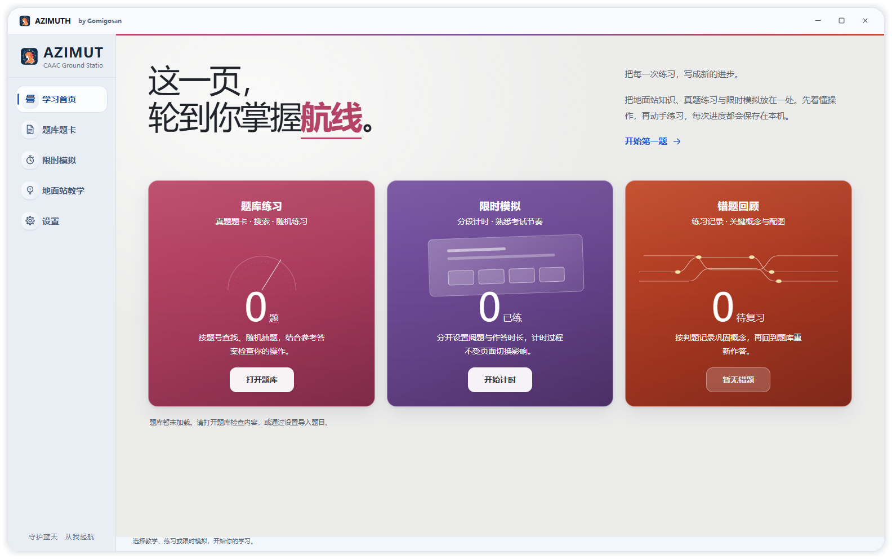

# AZIMUTH · 方位角

地面站学习辅助工具：导入自己的题卡，按考试节奏练习，结合自动审题与 AI 参考思路复盘。

**[GitHub Releases](https://github.com/watanabe2016/AZIMUTH/releases) · [访问官网](https://azimuth.xin/) · [下载 Windows v1.0 安装包](https://azimuth.xin/downloads/AZIMUTH-v1.0-Setup.exe)**

## 主要功能

- **分段计时**：分别设置阅题和作答时长，支持到点提示、自定义时长与练习记录。
- **个人题库**：导入 PDF 或图片，搜索题目、随机练习、管理学习进度。软件不附带题库。
- **自动审题**：梳理题目条件，并结合地面站任务数据核对作答。
- **AI 参考答案**：使用自行配置的模型服务生成参考思路、航图和分段航线表。
- **外观设置**：浅色、深色、跟随系统，以及默认主题与工业极简主题。

AI 内容用于辅助学习，请对照原题复核。模型服务可能收取费用，API Key 由使用者自行配置并保存在本机。



## 从源码运行

建议使用 Windows 10/11 64 位和 Python 3.13。软件依赖 Qt，核心桌面功能面向 Windows；官网是独立静态页面。

```powershell
git clone https://github.com/watanabe2016/AZIMUTH.git
cd AZIMUTH
python -m venv .venv
.venv\Scripts\python.exe -m pip install -r requirements.txt
.venv\Scripts\python.exe app/main.py
```

也可在安装依赖后双击 `启动AZIMUTH.bat`。首次启动会生成本地配置和数据目录；源码中不包含作者的个人数据。

详细操作说明见 [软件使用指南](docs/SOFTWARE_GUIDE.md)。

## 构建 Windows 程序

```powershell
.venv\Scripts\python.exe -m pip install -r requirements-dev.txt
.venv\Scripts\python.exe build/build_release.py
```

输出目录为 `dist-final/AZIMUTH/`。请整体分发该目录，不要只复制其中的 EXE。

开源仓库不存放安装包、第三方可执行文件及大型音乐文件。Tesseract 和 FFmpeg 的可选准备方法见 [可选运行资源](docs/OPTIONAL_RESOURCES.md)。源码构建与现有 v1.0 安装包可能在可选资源上有所区别。

## 官网源码

`website/` 包含官网首页、插件市场、皮肤市场、样式、脚本和公开展示素材，无需 Node.js 或前端构建。

```powershell
python -m http.server 4173 --bind 127.0.0.1 --directory website
```

打开 <http://127.0.0.1:4173/>。部署说明见 [官网说明](website/README.md)。

## 隐私与数据

题库、题卡图片、笔记、练习记录、日志、API Key 和服务器连接配置均不包含在仓库中。请勿在 Issue 或 Pull Request 中提交真实密钥、身份证件、私人题库或个人配置文件。

## 项目结构

```text
app/          桌面程序源码和内嵌页面
assets/       界面资源及第三方资源声明
build/        Windows 构建入口
docs/         使用、扩展与资源说明
tests/        原有回归测试
website/      静态官网源码
```

## 许可证

桌面软件代码采用 [AGPL-3.0](LICENSE)，官网自有代码采用 [MIT](website/LICENSE)。第三方依赖的许可范围见各自许可证与 [第三方声明](THIRD_PARTY_NOTICES.md)。第三方依赖和非代码素材不因收录在此仓库而改变其原有许可。
